# PPPCCC M:C Mods

Extra features for the **Elektron Model:Cycles OS 1.13**, the official firmware anyone can download from Elektron.
They also run on a **Model:Samples** that runs the Cycles OS.

**With version 2.3 this project has reached its final form, more or less, and with it I consider my work on it done.**
My goal was always to build my personal interpretation of the Model:Cycles and the Model:Samples: the instrument I
wanted for my own music, musical and hands-on, good to play live, with as little menu diving as possible. I am happy
about everyone who enjoys it too.

Everything here is open: **fork it, change it, take it further.** I would love to see where others take it.
Please understand that I don't have the capacity to take personal requests or to offer support or other services of
that kind. I will try to fix bugs here and there, as far as my time allows.

A big thank-you to all the modders who made this possible with their work and their inspiration (see
[Credits](#credits)).

**[☕ Buy me a coffee](https://ko-fi.com/pppccc)** ·
**[⚡ Flasher](https://gialloinfuso.github.io/PPPCCC-M-S-Mods/flasher/)** ·
**[⬇ Download (ZIP)](https://github.com/gialloinfuso/PPPCCC-M-S-Mods/archive/refs/heads/main.zip)** ·
**[Features](#patches)** ·
**[Project page](https://gialloinfuso.github.io/PPPCCC-M-S-Mods/)**

> **Status: v2.3.0, the final release.** Every patch was developed in an emulator and tested on my own Model:Samples
> running the Cycles OS. A real Model:Cycles has **not** been tested yet; the code paths are the same.
> New in v2.3.0: three machines (Grit, Vlvt, Monom), Hall / Room / Plate, per-track strum, parameter undo and pad mode,
> plus updates to most patches. The patch numbers changed. What changed: [changelog](docs/CHANGELOG.md#v230-2026-11-12).

## The core

Most patches build on a small **core** ([patch 00](docs/patches/00-core.md)). The flasher and the build tool add it
automatically. It holds what several patches share (gesture and key slots, value popups, pattern and sound storage for
extra parameters, a payload area for larger code), and it brings a few improvements of its own:

- **FUNC + DECAY = amp attack** (0 to about 2 s) on every machine, p-lockable and saved with the sound.
- **TRACK + T1…T6** selects the track; T1…T6 alone no longer do.
- **FUNC + knob** moves in fine steps like the knob alone, so FUNC + knob is free for extra parameters.
- A **multi-line browser** (three names in the small font) with **scrolling names**.
- **Volume and pan as numbers** on the main screen.
- **RETRIG opens the save menu** in the browser (shown as RT=MENU) instead of FUNC.

## Patches

Each feature is one patch; the number is the patch number, the newest come first. The heading links to the full page
with controls, storage, hooks, memory and tests. "Needs core" means the core is added with it.

### 19 · Pad Mode ([details](docs/patches/19-pad-mode.md)) · `NEW v2.3.0` · needs core

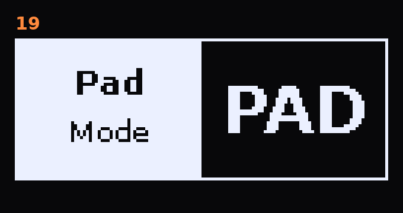

Turn a track into a **pad track**: the sequencer leaves it alone and the trig keys play its steps, with their p-locks,
note, length and sample lock. Hold **TRACK + RETRIG** to see the pad tracks, **TRACK + RETRIG + trig 1–6** to switch a
track. FUNC + trig adds or clears a step; MIDI notes 36–51 play the steps too.

### 18 · Parameter undo: 3x longer ([details](docs/patches/18-param-undo.md)) · `NEW v2.3.0`


The "old → new" popup after turning a knob stays three times as long, so **BACK** has more time to undo the change.

### 17 · Monom: monophonic synth ([details](docs/patches/17-mono.md)) · `NEW v2.3.0` · needs core, 15, 16

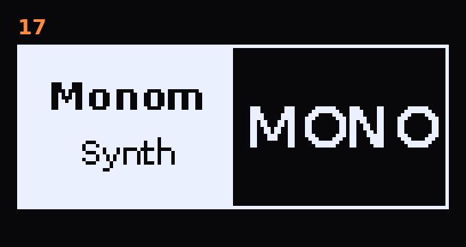

A 9th machine in the spirit of the SH-101, Minimoog, Pro-One and MS-20, warm and imperfect. **COLOR** = wave (SAW, SQR,
PWM, S+P, TRI, SYNC, DTN, RING), **SHAPE** = timbre, **SWEEP** = sub oscillator, **CONTOUR** = drive, **FUNC + PITCH** =
glide, **FUNC + CONTOUR** = noise. Drift, random detune and free-running phases. Use the track filter (12) as its filter.

### 16 · Vlvt: string machine ([details](docs/patches/16-strings.md)) · `NEW v2.3.0` · needs core, 15

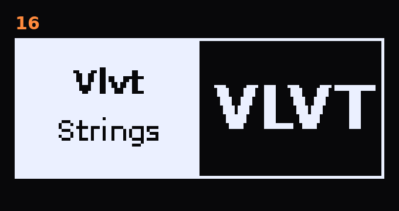

An 8th machine: a string ensemble in the style of a Solina. **SHAPE** = chord (the CHORD list, plus mono and unison),
**COLOR** = 8' / 4' mix, **SWEEP** = tone, **CONTOUR** = ensemble. Strummed with patch 06.

### 15 · Grit: sampler machine ([details](docs/patches/15-sampler.md)) · `NEW v2.3.0` · needs core

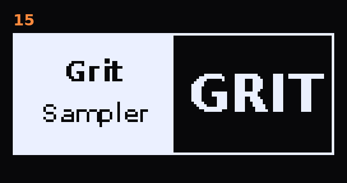

A 7th machine: a simple sampler in the style of the Model:Samples, with six models: **CLEAN**, **SP** (26 kHz,
12 bit, drop-sample), **LM** (28 kHz, 8-bit mu-law), **MIRAGE** (29.4 kHz, 8 bit), **TX16W** (33.3 kHz, 12-bit floating
point) and **MPC60** (40 kHz, 12-bit floating point). Samples come from the +Drive and are chosen in the browser.
**COLOR** = start, **SHAPE** = length (the waveform shows while you turn), **CONTOUR** = model, **PUNCH** = loop,
**GATE** = reverse. Sample locks lock only the sample. Upload samples with Elektron Transfer (Device Config > Transfer: SMP).

> Grit, Vlvt and Monom only work together: Vlvt needs Grit, Monom needs Grit and Vlvt.

### 14 · Direct Pattern Jump ([details](docs/patches/14-direct-jump.md)) · `UPDATE v2.3.0`

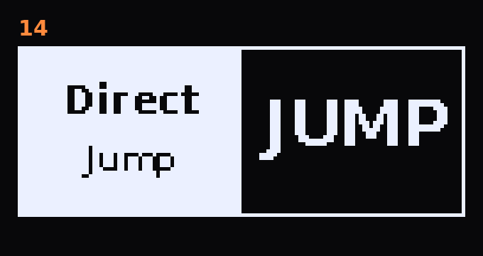

Change the pattern **right away** and keep the position: **PATTERN**, then **FUNC + a trig key**. A trig key alone
changes at the end of the pattern, as usual. **New:** the pattern selection latches (only PATTERN closes it), and
copying, pasting or clearing a pattern keeps it open.

### 13 · LFO Amount ([details](docs/patches/13-lfo-amount.md)) · needs core

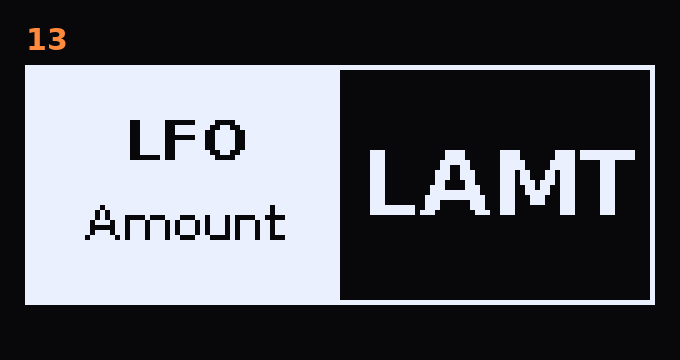

Hold **RETRIG** + turn **LFO SPEED** = how much of the LFO depth is used (0–127; 127 = as before). A real parameter:
p-lockable, LFO and velocity destination, saved with the sound.

### 12 · Per Track LP Filter + Env Amt & Latched Filter Mode ([details](docs/patches/12-track-filter.md)) · `UPDATE v2.3.0` · needs core

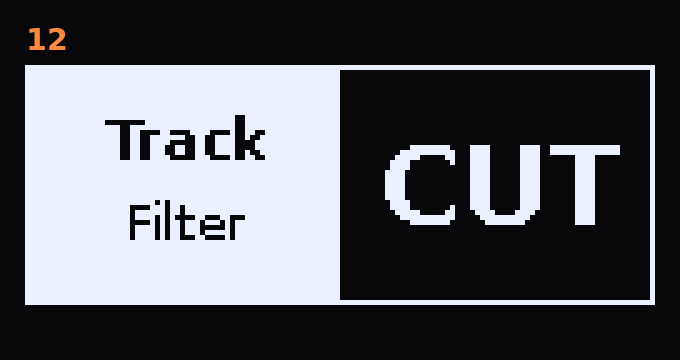

A resonant 12 dB low-pass filter with its own envelope on every track. **RETRIG + GATE** = filter mode: **PITCH** =
cutoff, **COLOR** = resonance, **SHAPE** = envelope amount, **DECAY** = envelope decay; tap **RETRIG** = off. Real
parameters (p-locks, LFO, velocity, CC 74 / 71). **New:** **GATE + PLAY** resets the filter of the selected track.

### 11 · Fill 2 & Trig Conditions ([details](docs/patches/11-fill2.md)) · `UPDATE v2.3.0`

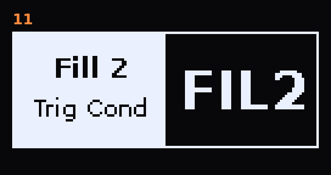

Hold **PAGE + FUNC** = Fill 2 with its own conditions **FIL2** / **!FIL2**. **New:** the conditions **PTC** / **!PTC**
(a new pattern is waiting) and **LST** / **!LST** (last pass before another pattern), **x:12** and **x:16**, and a
reordered list: A:B first, then FILL / FIL2 / PTC / PRE / NEI / 1st / LST, percentages last.

### 10 · Trigger Select Mode ([details](docs/patches/10-trig-select.md)) · needs core

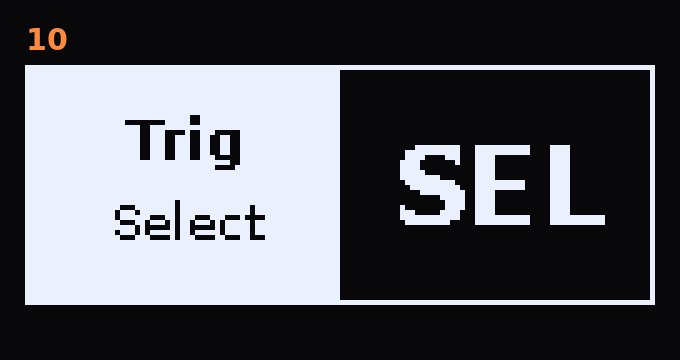

**SETTINGS + PAGE** = selection mode. Tap trigs to select them (they blink), **FUNC + PAGE** = all / none. Knobs, note /
velocity / length, nudge and REC / STOP / PLAY then act on all selected trigs, as if you held them.

### 09 · Control All & Parameter change absolute/relative ([details](docs/patches/09-control-mode.md)) · `UPDATE v2.3.0` · needs core

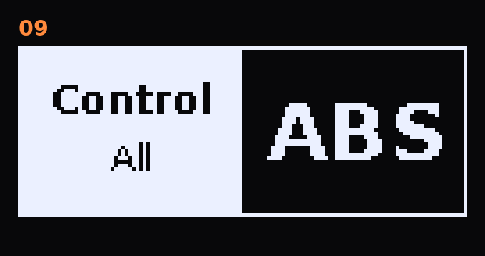

**TRACK + SETTINGS** switches CONTROL ALL between **relative** (stock) and **absolute** (all tracks take the new value).
**New:** hold **TRACK** to see which tracks CONTROL ALL affects, **TRACK + trig 1–6** adds or removes a track.

### 08 · Grooves and humanize ([details](docs/patches/08-groove.md)) · `UPDATE v2.3.0` · needs core

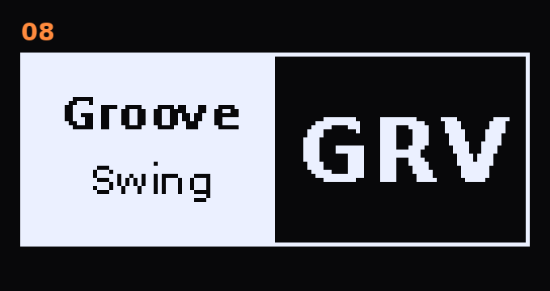

**FUNC + Swing** = groove: Swing, Boom Bap, Disco, Dancehall 1 / 2, Hip Hop, Jazz Rock, Perc 1–3, Soca (**new** set);
Swing per track = amount. **SETTINGS / MACHINE + Swing** = humanize timing / velocity (with TRACK: all tracks).

### 07 · Audio load meter ([details](docs/patches/07-load-meter.md)) · `UPDATE v2.3.0` · needs core

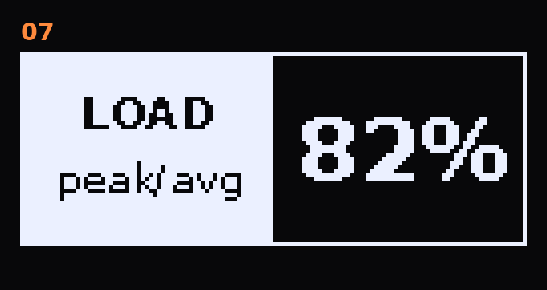

**RETRIG + BPM** (**new**) shows or hides "LOAD peak/average", the audio load in percent, updated every 0.5 s.

### 06 · Strum for CHORD and Vlvt ([details](docs/patches/06-strum.md)) · `UPDATE v2.3.0` · needs core

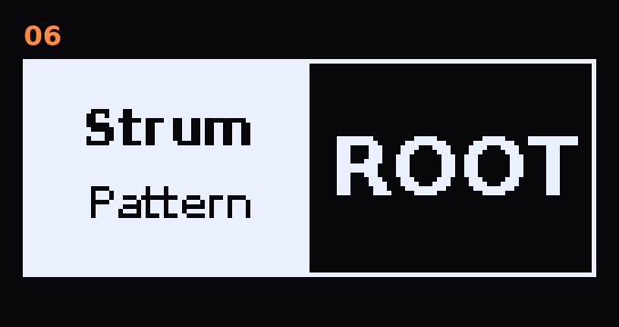

**New:** per track and saved with the sound. **FUNC + SHAPE** = strum time (OFF, 2–250 ms, then note values in tempo),
**FUNC + COLOR** = pattern: UP, DOWN, RND, 1324, 1423, 4132, 4231, ROOT, TOP. Every chord note gets its own envelope.

### 05 · Delay FX: Digital delay, VIBDEL, CHODEL ([details](docs/patches/05-delay-fx.md)) · `UPDATE v2.3.0` · needs core

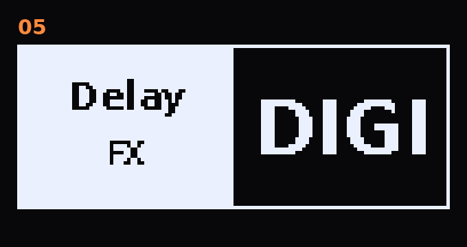

**TRACK + Delay Time**: Delay → Digital → VIBDEL → CHODEL. **FUNC + DELAY SEND** (**new**) = modulation speed.
Stored per pattern.

### 04 · Reverb FX: Chorus I / II, Phaser, RAZR, Hall, Room, Plate ([details](docs/patches/04-reverb-fx.md)) · `UPDATE v2.3.0` · needs core

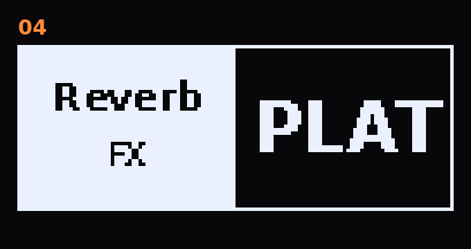

**TRACK + Reverb Size**: Reverb → Chorus I → Chorus II → Phaser → RAZR → **Hall → Room → Plate** (**new**, own
algorithms in the style of the Dragonfly Reverbs). Stored per pattern.

### 03 · Delay Time as note values ([details](docs/patches/03-delay-notes.md))

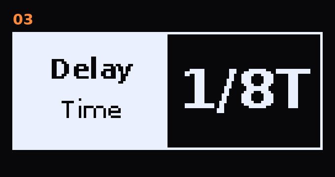

Delay Time shows note values (1/1 … 1/64, dotted, triplets), and the triplets are exact.

### 02 · Hold to mute ([details](docs/patches/02-hold-mute.md))

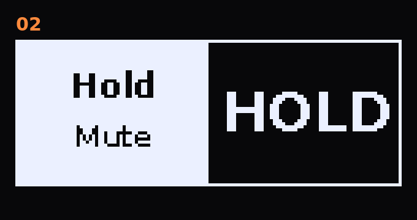

Sequencer running: hold **T1–T6** = that track is muted until you let go. A tap plays the sound.

### 01 · Mute: latching, solo and live notes ([details](docs/patches/01-mute-solo.md)) · `UPDATE v2.3.0`

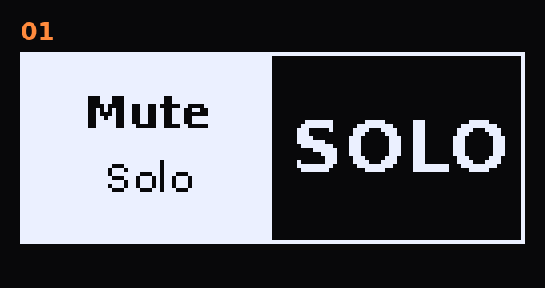

**TRACK + FUNC** latches the mute mode, **FUNC + track key** in that mode = solo (again =
previous mutes back), and muted tracks stay silent for pads and MIDI too. **New:** all three in one patch.

## Controls overview

| Patch | Control | Result |
|---|---|---|
| 00 Core | hold **FUNC** + turn **DECAY** | amp attack |
| 00 Core | **TRACK + T1–T6** | select the track |
| 00 Core | browser: **RETRIG** | save menu |
| 01 Mute | hold **TRACK**, tap **FUNC** · tap **FUNC** | latching mute mode on · off |
| 01 Mute | latched mode: hold **FUNC** + track key | solo; again = previous mutes back |
| 02 Hold to mute | sequencer running: hold **T1–T6** | track muted until release |
| 03 Delay notes | turn **Delay Time** | note values, exact triplets |
| 04 Reverb FX | hold **TRACK** + turn **Reverb Size** | Reverb → Chorus I → Chorus II → Phaser → RAZR → Hall → Room → Plate |
| 05 Delay FX | hold **TRACK** + turn **Delay Time** | Delay → Digital → VIBDEL → CHODEL |
| 05 Delay FX | hold **FUNC** + turn **DELAY SEND** | VIBDEL / CHODEL speed |
| 06 Strum | hold **FUNC** + turn **SHAPE** · **COLOR** | strum time · strum pattern (CHORD / Vlvt tracks) |
| 07 Load meter | hold **RETRIG** + press **BPM** | meter on / off |
| 08 Groove | hold **FUNC** + turn **Swing** · turn **Swing** | groove · amount per track |
| 08 Humanize | hold **SETTINGS** / **MACHINE** + turn **Swing** (+ **TRACK** = all) | timing / velocity |
| 09 Control All | hold **TRACK** + tap **SETTINGS** | relative ↔ absolute |
| 09 Control All | hold **TRACK** + trig **1–6** | add / remove a track |
| 10 Trig select | **SETTINGS + PAGE** · in the mode: trigs · **FUNC + PAGE** | mode on / off · select · all / none |
| 11 Fill 2 | hold **PAGE**, then also **FUNC** | Fill 2 |
| 12 Track filter | hold **RETRIG** + press **GATE** · tap **RETRIG** | filter mode on · off |
| 12 Track filter | filter mode: **PITCH** / **COLOR** / **SHAPE** / **DECAY** | cutoff / resonance / env amount / env decay |
| 12 Track filter | hold **GATE** + press **PLAY** | filter reset of the track |
| 13 LFO Amount | hold **RETRIG** + turn **LFO SPEED** | LFO amount 0–127 |
| 14 Direct jump | **PATTERN**, then **FUNC** + trig | jump now, keep the position |
| 15 Grit | **COLOR** / **SHAPE** / **CONTOUR** · **FUNC + COLOR** · **PUNCH** / **GATE** | start / length / model · move both · loop / reverse |
| 16 Vlvt | **SHAPE** / **COLOR** / **SWEEP** / **CONTOUR** | chord / 8'-4' mix / tone / ensemble |
| 17 Monom | **COLOR** / **SHAPE** / **SWEEP** / **CONTOUR** · **FUNC + PITCH** / **CONTOUR** | wave / timbre / sub / drive · glide / noise |
| 18 Param undo | **BACK** while the value popup shows | undo (3x longer) |
| 19 Pad mode | hold **TRACK + RETRIG** (+ trig **1–6**) | show (switch) pad tracks |

What is saved where, and all controls with their parameters: [docs/USER_GUIDE.md](docs/USER_GUIDE.md) ·
Version history: [docs/CHANGELOG.md](docs/CHANGELOG.md)

## Why there is no .syx download

A firmware file contains Elektron's operating system, which I am not allowed to redistribute. This repository only
holds **my own code**: the bytes each patch writes, plus a SHA-256 checksum of the original bytes it replaces. No
Elektron code is in here. Where a hook has to move a few original instructions into a patch's own code, the patch
file holds only a placeholder and a checksum; the build tool copies those bytes from your own firmware file.
You build the
firmware from your own copy of the official file, in the [flasher](https://gialloinfuso.github.io/PPPCCC-M-S-Mods/flasher/)
or with the build tool. The build checks every single write, and also the complete result against a published
checksum.

## Build it

You need Python 3 and the official `model-cycles_OS1.13.syx` from elektron.se — nothing else. The firmware container
code comes with the repository (`tools/vendor/`: unchanged MIT copies from drumkilla's elektron-model-tweaks and
Modded-Cycles, so the build keeps working even if those repositories change).

```sh
git clone https://github.com/gialloinfuso/PPPCCC-M-S-Mods
cd PPPCCC-M-S-Mods
python3 tools/build.py --in model-cycles_OS1.13.syx --out cycles-mods
# -> cycles-mods_cyc-os.syx
```

To install only some features, name them; the core and the other patches a patch needs are added:

```sh
python3 tools/build.py --in model-cycles_OS1.13.syx --out my-mods mute-solo reverb-fx track-filter
```

For a **Model:Samples** you first make the Cycles OS for the Samples with Modded-Cycles' cross-flash tool (also in
`tools/vendor/`), then build from that file. Both are covered in [docs/BUILD.md](docs/BUILD.md).

As with any firmware mod: **use at your own risk**. The start-up menu (hold **FUNC** at power-on) can always bring
back an official OS.

## Repository layout

```
patches/   one JSON per patch (offsets, new bytes, SHA-256 of the original bytes) + manifest.json
tools/     build.py (.syx -> .syx), apply_patches.py (MAIN OS image -> image),
           vendor/ (container code from elektron-model-tweaks and Modded-Cycles, MIT, unchanged)
docs/      user guide, build guide, technical reference, changelog, one page per patch
grooves/   the groove tables (grooves.json)
src/       the generators: readable ColdFire assembler in Python (comments in German), regen.py
tests/     the emulator tests (run_all.py)
assets/    title images (README and project page)
```

You do not need `src/` or `tests/` to build the firmware. They are here for transparency, and so others can check the
work and build on it. See [docs/TECHNICAL.md](docs/TECHNICAL.md) and [src/README.md](src/README.md).

## Credits

This project stands on the work of others. Thank you!

- **drumkilla** ([elektron-model-tweaks](https://github.com/drumkilla/elektron-model-tweaks), MIT): the **latching mute**
  (part of patch 01) and the **scrolling browser names** (part of the core), rebuilt here with the same behaviour; the
  firmware container code (`mtlib`, included in `tools/vendor/`); the idea of playing a step (trig-preview) used by pad
  mode.
- **18nelli18 and the Modded-Cycles contributors** ([Modded-Cycles](https://github.com/18nelli18/Modded-Cycles), MIT):
  firmware research notes, the emulator rigs, the sprite-mask method for free memory, the compression of a longer MAIN
  OS and the cross-flash for the Model:Samples (both included in `tools/vendor/`). The multi-line browser and the volume / pan numbers of the core are
  ports of their `multiline-browser` and `level-pan-values` (the latter after a mod by djd_oz), rewritten here.
- **durchgemacht** ([model27](https://durchgemacht.github.io/model27/), MIT): the idea of the CONTROL ALL track
  selection (patch 09) and the loading guards of its sampler.
- **TinyGregAudio** (Model-TG, MIT): the idea of the amp attack and the Transfer identity switch of Grit.
- **jpcima** (string-machine) after the model by **Peter Whiting**: the inspiration for Vlvt.
- The **Dragonfly Reverbs** and Jon Dattorro's plate: the inspiration for Hall, Room and Plate.
- **Vadim Zavalishin** (*The Art of VA Filter Design*): the filter structure of the track filter.
- All code in this repository is my own; nothing was copied from these projects. Details in
  [THIRD-PARTY-NOTICES.md](THIRD-PARTY-NOTICES.md).

## License

My code, patches, documentation and groove tables: MIT, see [LICENSE](LICENSE). The files in `tools/vendor/` keep
their own MIT licenses (next to them). Elektron's firmware is not covered by these licenses and is not included.
