# PPPCCC M:S Mods

Extra features for the **Elektron Model:Cycles OS 1.13**, the official firmware anyone can download from Elektron.
They also run on a **Model:Samples** that runs the Cycles OS. You get solo and better mutes, tempo-synced delay notes,
new effects, strummed chords, grooves with humanize, an audio load meter, absolute CONTROL ALL, a selection mode
for trigs and a second fill.

Every feature is a separate patch with its own documentation, generator and emulator test, and you can choose which
ones you install.

> **Status: v2.1.0.** Every patch was developed in an emulator and tested on my own Model:Samples running the Cycles OS.
> A real Model:Cycles has **not** been tested yet. The code paths are the same, but please report back if you try it.
> Coming from v1.0.0? Read [what changed](docs/CHANGELOG.md#upgrading-from-v100).

## Features

Each feature is one patch; the number is the patch number. The newest come first. A click on a demo picture plays
the sound recording (it opens on the project page, [gialloinfuso.github.io/PPPCCC-M-S-Mods](https://gialloinfuso.github.io/PPPCCC-M-S-Mods/)). The heading links to the full page
with storage, hooks, memory and tests. Patches 05–11 build on a small **core** (patch 00), which the build tool adds
automatically; 01–04 and 12 need nothing else.

### 12 · Fill 2 ([details](docs/patches/12-fill2.md))

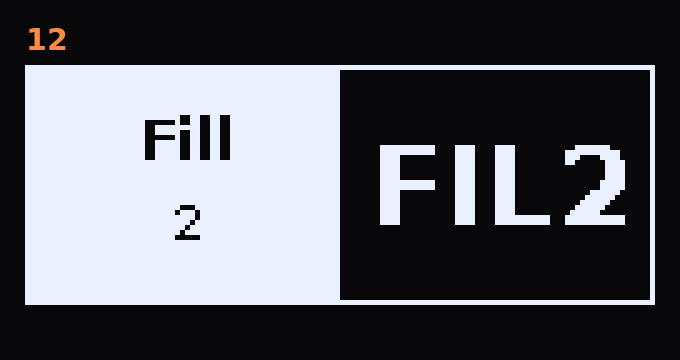

A second fill with its own trig conditions. **Hold PAGE** for the fill as usual, then **also hold FUNC**: as long as
both are held, Fill 2 replaces Fill 1. Let go of FUNC and you are back in Fill 1. With the fill latched (TRACK + PAGE),
holding FUNC switches to Fill 2 too.

Two new trig conditions belong to it. In the list they come right after FILL and !FILL: FILL, !FILL, **FIL2**,
**!FIL2**, PRE, …

| Condition | no fill | Fill 1 (PAGE) | Fill 2 (PAGE + FUNC) |
|---|---|---|---|
| FILL | – | plays | – |
| !FILL | plays | – | plays |
| FIL2 | – | – | plays |
| !FIL2 | plays | plays | – |

Patterns from the stock OS load unchanged. On a firmware without this patch, FIL2 and !FIL2 trigs always play.

### 11 · Trig select ([details](docs/patches/11-trig-select.md))


Edit many trigs at once without holding them all down, because you only have so many fingers.

- **SETTINGS + PAGE** turns the selection mode on or off (off clears the selection).
- In the mode, **tap a trig** to select or deselect it. Selected trigs blink fast. Trigs are not set or cleared.
- **FUNC + PAGE** selects all trigs of the track, again = none. **PAGE** changes the page as usual.

The firmware treats the selected trigs as if you held them. So everything that works on held trigs works on the
selection:

- **Knobs** p-lock all selected trigs. **Note, velocity, length and nudge** change all of them.
- **REC** copies the selected trigs ("Copy N Trigs"), **STOP** pastes the copied trigs starting at the first selected
  step, **PLAY** clears the p-locks of the selected trigs.

With control mode **Absolute**, all selected trigs take the value of the first selected trig; with **Relative** every
trig keeps its own offset.

### 10 · Control mode: relative or absolute CONTROL ALL ([details](docs/patches/10-control-mode.md))

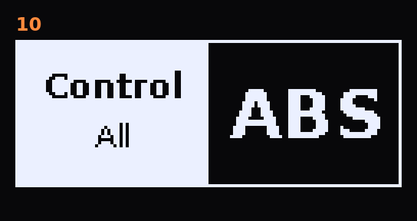

**Hold TRACK + turn a knob** changes that parameter on all six tracks (CONTROL ALL). The firmware does this
**relatively**: every track moves by the same amount from its own value, and stops at its limit. This patch adds
**absolute** mode: all tracks take the new value of the selected track.

- **Hold TRACK + tap SETTINGS** switches between Relative and Absolute. A popup shows the mode.
- It applies to TRACK + any knob, TRACK + LEVEL (volume), FUNC + TRACK + LEVEL (pan), the humanize of patch 09 and
  the trig selection of patch 11.
- Relative is the stock behaviour and the default. The setting is kept after power-off.

### 09 · Grooves and humanize ([details](docs/patches/09-groove.md))

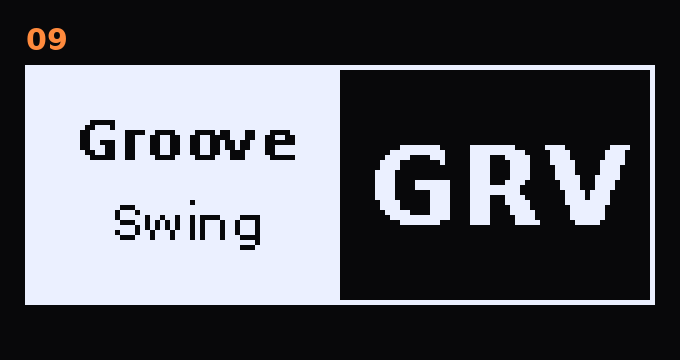

**Grooves.** A groove template shifts and accents the 16th steps. **Hold FUNC + turn Swing** to choose it (4 detents
per step, the popup shows the name):

| Groove | Length | Feel |
|---|---|---|
| Swing | – | the firmware's own swing (stock) |
| Boom Bap | 1 bar | laid-back hip-hop 16ths |
| Disco | 1 bar | live-feel disco 16ths |
| Reggae | 4 bars | displaced accents, loose feel |
| Bongo | 4 bars | bongo 16ths |
| Caixixi | 1 bar | shaker accents |
| Highlife | 2 bars | clave accents |
| Kuduro | 2 bars | displaced 8th-note triplet accents |

Each track's own **Swing** sets how strongly that track follows the groove: at the minimum it plays straight, at the
maximum it plays the full groove, both timing and accents. So the hi-hat can groove while the kick stays straight.

[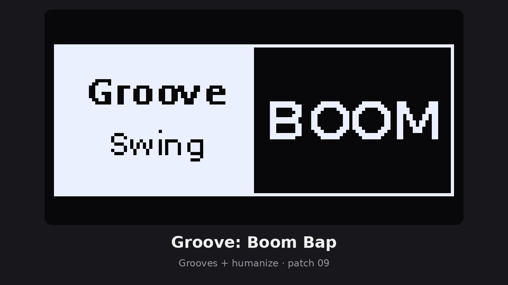](https://gialloinfuso.github.io/PPPCCC-M-S-Mods/assets/videos/Groove_BoomBap.mp4)

**Humanize** adds small random variations per track, on top of any groove (also on Swing):

- **Hold SETTINGS + turn Swing** = humanize **timing** of the selected track, 0–100. At 100, notes move up to ±0.15
  step, about ±19 ms at 120 BPM.
- **Hold MACHINE + turn Swing** = humanize **velocity** of the selected track, 0–100. At 100, up to about ±29 %.
- **Hold TRACK as well** to change all six tracks at once (relative or absolute, see patch 10).

Groove and humanize are saved **in the pattern**, so every pattern can have its own feel. To make MACHINE usable as a
modifier, the MACHINE menu now opens on release instead of on press.

### 08 · Load meter ([details](docs/patches/08-load-meter.md))

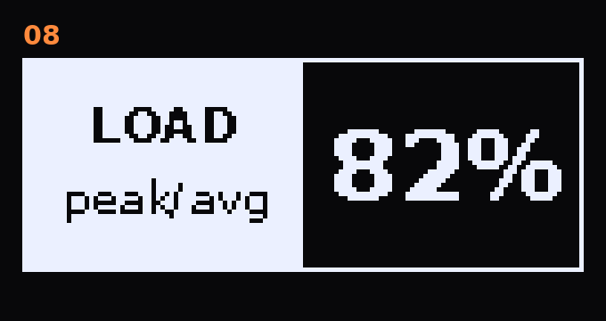

Shows how busy the audio engine is. When the load gets close to 100 %, the controls feel sluggish, because the
interface only gets the time the audio leaves over. **Hold SETTINGS + turn REVERB SEND right** to show a small box
"LOAD peak/average" in percent, updated every half second. Turn it **left** to hide it. The meter is always off after
power-on.

For reference, on a Model:Samples: idle 82/76, VIBDEL 83/78, CHODEL 85/80, CHODEL + RAZR 89/85. The stock firmware
alone already uses about three quarters.

### 07 · Chord Strum ([details](docs/patches/07-strum.md))

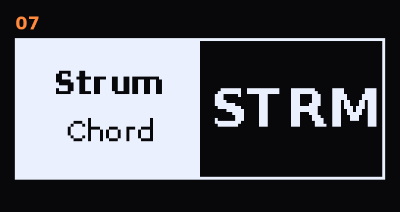

The CHORD machine plays its notes one after another, like a strummed guitar, instead of all at once. **Hold SETTINGS
+ turn SHAPE**:

- **0**: all notes at once (stock)
- **right, 1 to 80**: low to high, the value is the time between two notes in milliseconds
- **left, −1 to −80**: high to low

The root note is part of the strum too. The value is saved **in the pattern** and applies to every CHORD track.

[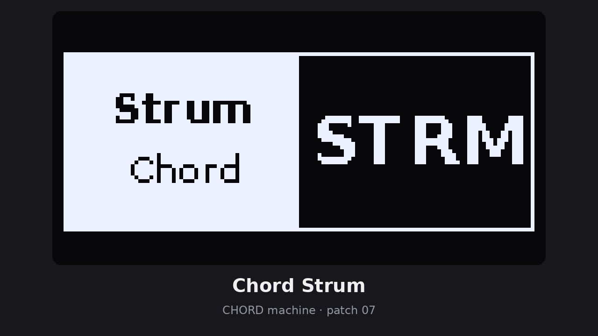](https://gialloinfuso.github.io/PPPCCC-M-S-Mods/assets/videos/Chord_Strum.mp4)

### 06 · Delay FX: Digital Delay, Vibrato Delay / Chorus Delay (VIBDEL / CHODEL) ([details](docs/patches/06-delay-fx.md))

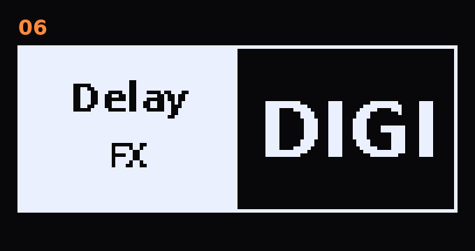

Three new delays for the delay slot. **Hold TRACK + turn Delay Time** to switch Delay → Digital → VIBDEL → CHODEL
(4 detents per step). Time, Feedback and Send work as usual, including the note values and exact triplets of patch 04.
The choice is saved **in the pattern**.

- **Digital**: the opposite of the dark stock delay. Bright and clean, up to 5.4 s. Every repeat stays bright
  (low-pass about 12.8 kHz instead of about 1.4 kHz) and gets a little thinner in the lows (high-pass about 240 Hz),
  so long feedback tails stay clear.
- **VIBDEL**: vibrato on the delay. The feedback is modulated too, so the repeats get more and more wobbly.
- **CHODEL**: a clean repeat plus a chorused one, left and right moving in opposite directions, for a wide sound.
- **Hold SETTINGS + turn DELAY SEND** = modulation speed of VIBDEL / CHODEL. A popup shows the value.

The repeats of VIBDEL and CHODEL are slightly darker and thinner than the original, like a tape or bucket-brigade delay.

**Digital Delay**

[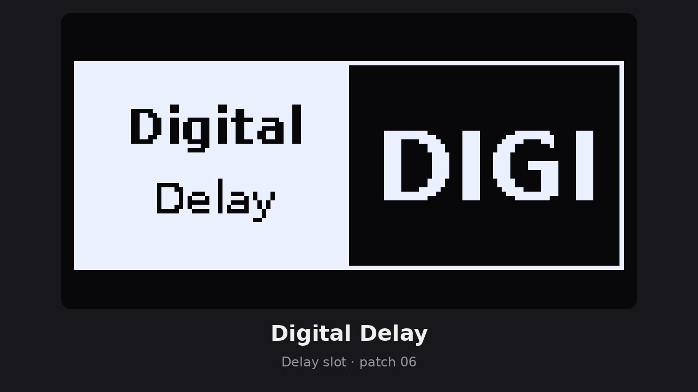](https://gialloinfuso.github.io/PPPCCC-M-S-Mods/assets/videos/Digital_Delay.mp4)

**Vibrato Delay (VIBDEL)**

[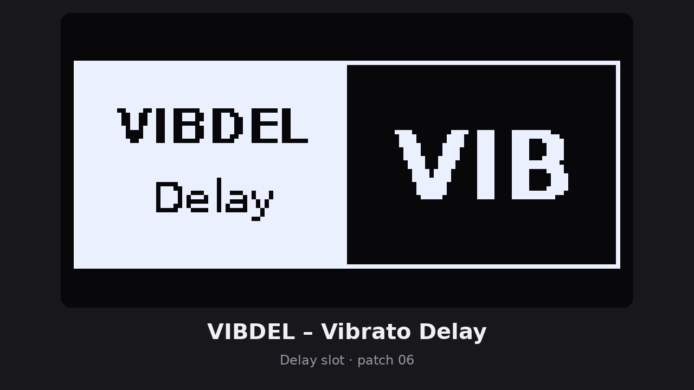](https://gialloinfuso.github.io/PPPCCC-M-S-Mods/assets/videos/Vibrato_Delay.mp4)

**Chorus Delay (CHODEL)**

[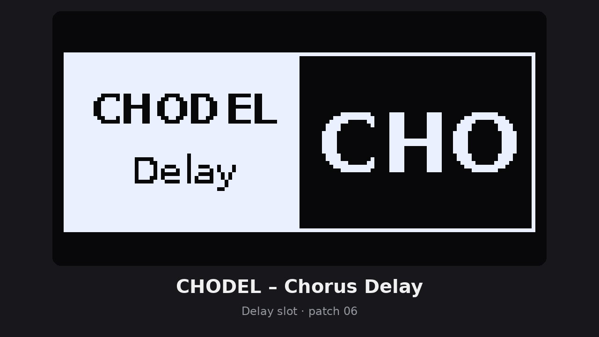](https://gialloinfuso.github.io/PPPCCC-M-S-Mods/assets/videos/Chorus_Delay.mp4)

### 05 · Reverb FX: Chorus I / II, Phaser, Reverb-Phaser (RAZR) ([details](docs/patches/05-reverb-fx.md))

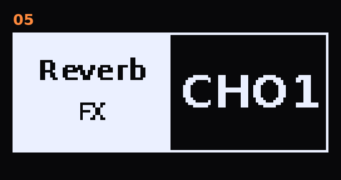

Four new effects for the reverb slot. **Hold TRACK + turn Reverb Size** to switch Reverb → Chorus I → Chorus II →
Phaser → RAZR. One step needs 4 detents, so you don't skip past an effect by accident, and the parameter names change
at once. Every track's reverb send feeds the chosen effect. The choice is saved **in the pattern**, so each pattern can
have its own effect.

- **Chorus I / Chorus II**: a lush stereo chorus with two modes, in the style of classic 80s polysynth choruses.
  **Size** = speed, **Tone** = depth.
- **Phaser**: a 4-stage phaser in the style of classic phaser pedals. **Size** = speed (0.1–6 Hz), **Tone** = color.
- **RAZR**: a dark, gritty lo-fi reverb that feeds a phaser. **Send** = mix, **Size** = reverb length, **Tone** = phaser
  speed (0.05–4.9 Hz; at 0 you hear only the lo-fi reverb).

**Chorus I**

[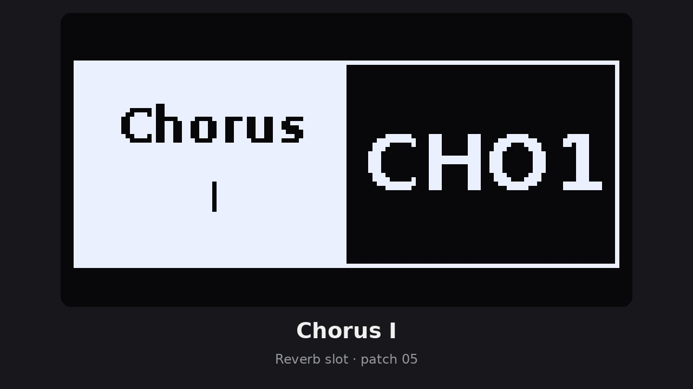](https://gialloinfuso.github.io/PPPCCC-M-S-Mods/assets/videos/Chorus_I.mp4)

**Chorus II**

[](https://gialloinfuso.github.io/PPPCCC-M-S-Mods/assets/videos/Chorus_II.mp4)

**Phaser**

[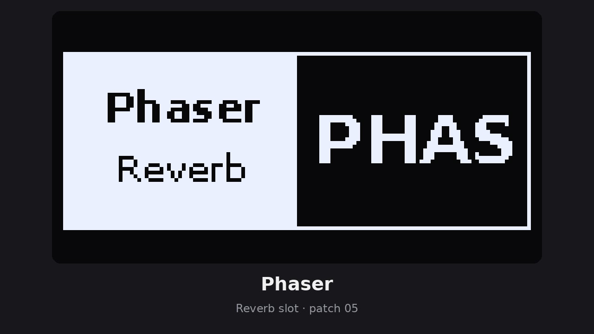](https://gialloinfuso.github.io/PPPCCC-M-S-Mods/assets/videos/Phaser.mp4)

**RAZR**

[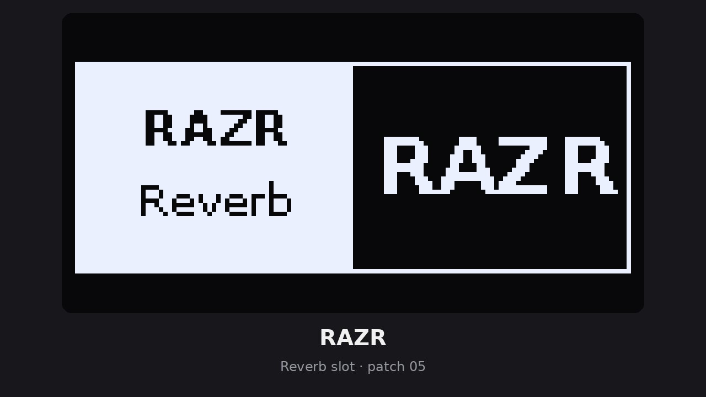](https://gialloinfuso.github.io/PPPCCC-M-S-Mods/assets/videos/RAZR.mp4)

### 04 · Delay notes ([details](docs/patches/04-delay-notes.md))

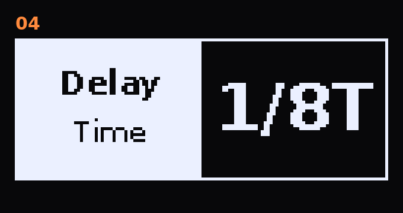

The delay of the Model:Cycles is tempo-synced, but Delay Time only shows numbers. With this patch the musical
positions show note values:

| Even | Dotted | Triplets |
|---|---|---|
| 1/1, 1/2, 1/4, 1/8, /16, /32, /64 | 2., 4., 8., 16., 32. | 1T, 2T, 4T, 8T, 16T |

The stock OS cannot hit a triplet exactly, because it counts in 1/128 notes. At the five triplet positions the patch
adds the missing fraction, so 1/8T really is an eighth-note triplet. All other values sound exactly as before.

### 03 · Hold to mute ([details](docs/patches/03-hold-mute.md))

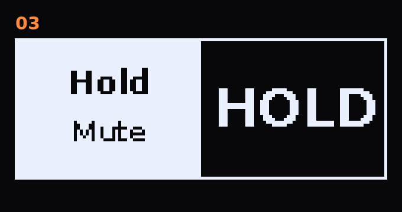

For quick drop-outs while the sequencer runs: **hold a pad T1–T6** for about 200 ms or longer, and its track is
muted until you let go. It is the normal track mute: sequencer notes drop out, sounds that are ringing decay
naturally.

- A short tap still plays the sound (on release).
- If the track was already muted, it stays muted.
- With the sequencer stopped, the pads play normally, on press.

### 02 · Live mute ([details](docs/patches/02-live-mute.md))

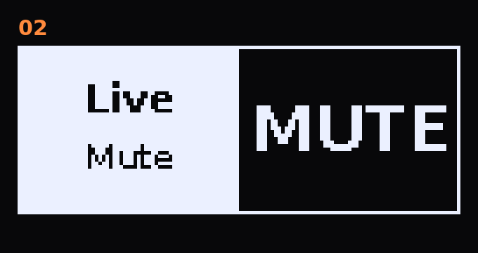

On the stock OS a muted track still plays when you hit its pad or send it a MIDI note. With this patch a muted
track stays silent for pads, the keyboard and incoming MIDI. Only note-on is dropped, so muting while a note is held
cannot leave a hanging note. There is nothing to set: it works in every mute mode.

### 01 · Solo ([details](docs/patches/01-mute-solo.md))

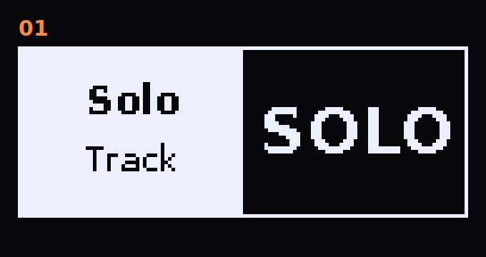

Solo one track for a moment, then go back to exactly the mutes you had before. Solo works in the **latching mute
mode** from drumkilla's latching-mute patch, which the build always includes: hold **TRK** and tap **FUNC**, and the
FUNC key lights up.

- In the latching mode, **hold FUNC + press a track key**: that track plays, all others are muted.
- The same again: your previous mutes come back.
- FUNC + another track key while soloed: the solo moves to that track. Your mutes from before the first solo stay saved.
- A track key without FUNC toggles that mute as usual and ends the solo.

## Controls overview

| Feature | Control | Result |
|---|---|---|
| 12 Fill 2 | hold **PAGE**, then also **FUNC** | Fill 2 instead of Fill 1 (also with TRACK + PAGE latched) |
| 12 Fill 2 | trig conditions **FIL2** / **!FIL2** | play only in Fill 2 / play except in Fill 2 |
| 11 Trig select | **SETTINGS + PAGE** | selection mode on / off |
| 11 Trig select | in the mode: tap trigs · **FUNC + PAGE** | select / deselect · all / none |
| 11 Trig select | with a selection: knobs · REC · STOP · PLAY | p-lock · copy · paste · clear locks for all selected |
| 10 Control mode | hold **TRACK** + tap **SETTINGS** | CONTROL ALL relative ↔ absolute |
| 09 Groove | hold **FUNC** + turn **Swing** | choose the groove |
| 09 Groove amount | turn **Swing** | how much this track follows the groove |
| 09 Humanize timing | hold **SETTINGS** + turn **Swing** | selected track, 0–100 |
| 09 Humanize velocity | hold **MACHINE** + turn **Swing** | selected track, 0–100 |
| 09 Humanize, all tracks | hold **TRACK** + **SETTINGS** / **MACHINE** + turn **Swing** | all six tracks at once |
| 08 Load meter | hold **SETTINGS** + turn **REVERB SEND** | right = on, left = off |
| 07 Strum | hold **SETTINGS** + turn **SHAPE** | −80…80 ms between chord notes |
| 06 Delay FX | hold **TRACK** + turn **Delay Time** | Delay → Digital → VIBDEL → CHODEL |
| 06 Mod delay speed | hold **SETTINGS** + turn **DELAY SEND** | VIBDEL / CHODEL speed |
| 05 Reverb FX | hold **TRACK** + turn **Reverb Size** | Reverb → Chorus I → Chorus II → Phaser → RAZR |
| 04 Delay notes | turn **Delay Time** | note values, exact triplets |
| 03 Hold to mute | sequencer running: hold **T1–T6** | track muted until release |
| 02 Live mute | mute a track | pads and MIDI notes stay silent too |
| Latching mute (drumkilla) | hold **TRK**, tap **FUNC** | latching mute mode on (FUNC lights up) |
| 01 Solo | latching mode: hold **FUNC** + track key | solo; again = previous mutes back |

What is saved where, and all controls with their parameters: [docs/USER_GUIDE.md](docs/USER_GUIDE.md) ·
Version history: [docs/CHANGELOG.md](docs/CHANGELOG.md)

## Why there is no .syx download

A firmware file contains Elektron's operating system, which I am not allowed to redistribute. This repository only
holds **my own code**: the bytes each patch writes, plus a SHA-256 checksum of the original bytes it replaces. No
Elektron code is in here. Where a hook has to move a few original instructions into a patch's own code, the patch
file holds only a placeholder and a checksum; the build tool copies those bytes from your own firmware file. You
build the firmware from your own copy of the official file. The build checks every single write, and also the
complete result against a published checksum.

## Build it

You need Python 3, the official `model-cycles_OS1.13.syx` from elektron.se, and a checkout of
[drumkilla/elektron-model-tweaks](https://github.com/drumkilla/elektron-model-tweaks). That checkout supplies the
firmware container code and the latching-mute patch that Solo builds on.

```sh
git clone https://github.com/drumkilla/elektron-model-tweaks
python3 tools/build.py --tweaks elektron-model-tweaks --in model-cycles_OS1.13.syx --out cycles-mods
# -> cycles-mods_cyc-os.syx
```

To install only some features, name them; the core is added when a patch needs it:

```sh
python3 tools/build.py --tweaks elektron-model-tweaks --in model-cycles_OS1.13.syx --out my-mods \
        live-mute reverb-fx trig-select
```

For a **Model:Samples** you first make the Cycles OS for the Samples with Modded-Cycles' cross-flash tool, then
build from that file. Both are covered in [docs/BUILD.md](docs/BUILD.md).

As with any firmware mod: **use at your own risk**. The start-up menu (hold **FUNC** at power-on) can always bring
back an official OS.

## Repository layout

```
patches/   one JSON per patch (offsets, new bytes, SHA-256 of the original bytes) + manifest.json
tools/     build.py (.syx -> .syx), apply_patches.py (MAIN OS image -> image)
docs/      user guide, build guide, technical reference, changelog, one page per patch
grooves/   the groove tables (grooves.json)
src/       the generators that produce the ColdFire code (comments in German), regen.py
tests/     the emulator tests (run_all.py)
assets/    title images, demo pictures and sound demos (README and project page)
```

You do not need `src/` or `tests/` to build the firmware. They are here for transparency, and so others can
check the work and build on it. See [docs/TECHNICAL.md](docs/TECHNICAL.md).

## Credits

- **Latching mute** is by **drumkilla** ([elektron-model-tweaks](https://github.com/drumkilla/elektron-model-tweaks), MIT).
  The solo extension (patch 01) is mine and needs it.
- Firmware research, the emulator rigs, the sprite-mask method for free memory and the cross-flash for the Model:Samples
  come from [Modded-Cycles](https://github.com/18nelli18/Modded-Cycles) (MIT).
- More in [THIRD-PARTY-NOTICES.md](THIRD-PARTY-NOTICES.md).

## License

My code, patches, documentation and groove tables: MIT, see [LICENSE](LICENSE). Elektron's firmware is not covered by
this license and is not included.
